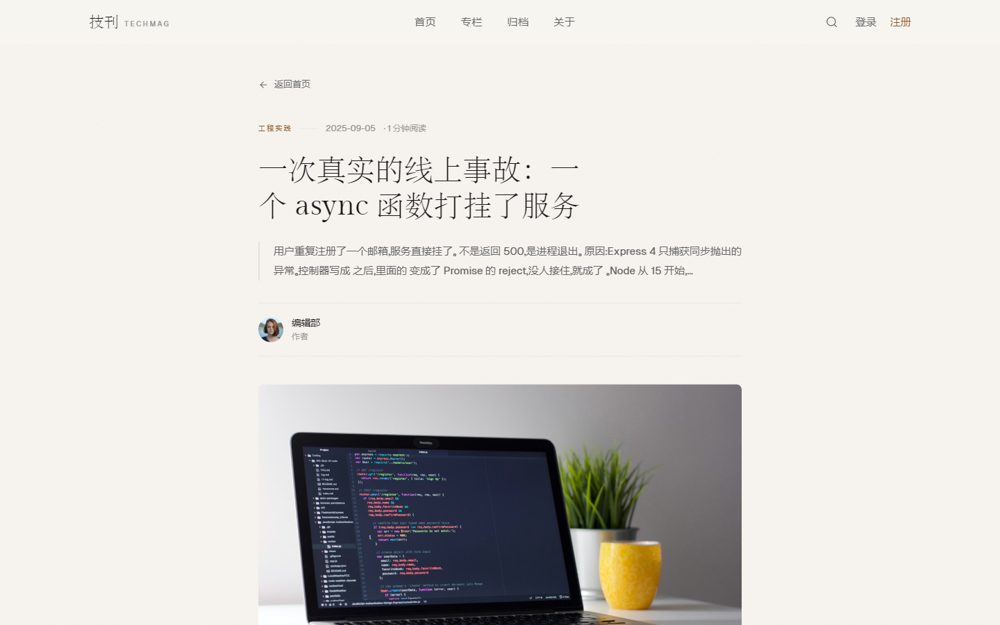

# 技刊 TechMag · 前端

> 一个米白纸质质感的杂志风技术博客。用分栏、首字下沉、刊号、通栏引用与错落卡片
> 还原真实刊物的阅读节奏，而不是套一层卡片网格。
>
> 配套后端：[`blog-backend`](https://github.com/qmoxue/blog-backend)
> 在线演示：[https://qmoxue.github.io/blog-frontend/](https://qmoxue.github.io/blog-frontend/)（仓库启用 GitHub Pages 后生效）


<div align="center">
  
  
</div>

---

## 目录

- [功能一览](#功能一览)
- [技术栈](#技术栈)
- [快速开始](#快速开始)
- [与后端的配合](#与后端的配合)
- [目录结构](#目录结构)
- [实现要点](#实现要点)
- [部署](#部署)
- [测试与质量](#测试与质量)
- [相关仓库](#相关仓库)

---

## 功能一览

| 模块 | 能力 |
| --- | --- |
| 首页 | 刊头 + 精选大图 + 本月专栏 + 文章流（分组排版 + 通栏引用）+ 加载更多 |
| 文章详情 | Markdown 渲染（已消毒）+ 首字下沉 + 阅读时长 + 作者信息 |
| 专栏 / 归档 | 按专栏、年份、期数浏览 |
| 搜索 | 关键词实时搜索（带竞态处理与结果防抖） |
| 账号 | 注册、登录、登出；登录态用 httpOnly cookie + `GET /auth/me` 探测 |
| 作者编辑器 | 写稿 / 改稿 / 传封面 / 本地草稿 / 预览 / 发布 |
| 优雅降级 | 后端不可用时回退到本地演示数据，页面永不白屏 |
| 响应式 | 桌面三栏杂志排版 → 移动端单栏，导航收进抽屉 |

**工程约束**

- `vue-tsc` 严格模式类型检查，构建前必过
- 组件只认自己的类型，后端字段全部收敛在一层「防腐层」里
- Markdown 渲染后必须经 DOMPurify 消毒，杜绝存储型 XSS
- 动效只用 `opacity` / `transform`，`prefers-reduced-motion` 下自动关闭

---

## 技术栈

| | |
| --- | --- |
| 框架 | Vue 3 `<script setup lang="ts">` + TypeScript（strict） |
| 构建 | Vite 6 |
| 路由 | vue-router 4（**hash 模式**，见下方说明） |
| 样式 | Tailwind CSS 3.4（任意值精细控制字号、字重、行高、间距） |
| 动效 | @vueuse/motion + `<TransitionGroup>`；`v-reveal` 指令做视口淡入 |
| 工具 | @vueuse/core（`useScroll`、`useIntersectionObserver`）、lucide-vue-next |
| Markdown | markdown-it + DOMPurify |
| 测试 | Vitest |

> **为什么用 hash 路由**：GitHub Pages 的项目站点只能挂在 `/<仓库名>/` 子路径下，
> history 模式在这种路径下刷新会 404。hash 模式 + Vite `base: './'`
> 让同一份产物既能放根目录也能放任意子路径，部署时不需要改任何配置。

---

## 快速开始

### 环境要求

| 依赖 | 要求 | 检查命令 |
| --- | --- | --- |
| Node.js | **≥ 18**（Vite 6 要求，推荐 20/22 LTS） | `node -v` |
| npm | ≥ 9 | `npm -v` |

> Node 16 会在启动时报 `crypto$2.getRandomValues is not a function`——
> Vite 6 用到的 `globalThis.crypto.getRandomValues` 在 Node 19 之前不存在。
> 仓库里放了 `.nvmrc`，装了 nvm 直接 `nvm use` 即可。

### 启动

```bash
npm install

# 后端还没起时前端也能跑（会回退到本地演示数据），
# 想看真实数据请先按 blog-backend 的 README 启动后端并执行 npm run seed
cp .env.example .env        # 端口配置在 VITE_API_PORT，默认 8080

npm run dev                 # http://127.0.0.1:5173
```

> 打开页面请用 **`http://127.0.0.1:5173`**，不要用 `localhost:5173`——
> 代理是按 `127.0.0.1` 配的，两边不一致会出现「页面能开但接口全 404」的迷惑现象。

### npm scripts

| 命令 | 作用 |
| --- | --- |
| `npm run dev` | 开发服务器（Vite，带热更新） |
| `npm run build` | 类型检查 + 常规产物（`dist/`） |
| `npm run preview` | 本地预览 `dist/` |
| `npm run build:standalone` | 单文件产物（`dist-standalone/index.html`，可双击打开） |
| `npm run typecheck` | 只跑类型检查 |
| `npm test` | Vitest 单元测试 |

更详细的上手与逐项验收清单见 [`GETTING-STARTED.md`](GETTING-STARTED.md)。

---

## 与后端的配合

前端**永远先请求真实后端**，失败才回退到 `src/data/articles.ts` 里的本地演示数据：

```
组件 → api/articles.ts → api/client.ts → /api/v1/...  → 成功：真实数据
                                       ↓ 失败
                        src/data/articles.ts（本地兜底，页面不白屏）
```

请求地址一律写**相对路径** `/api/v1/...`，开发时由 Vite 代理转发到 `127.0.0.1:8080`，
生产时由 Nginx 同域反代。**不要写成 `http://localhost:8080`**——那样浏览器会当成跨域请求，
cookie 带不过去，登录态永远建立不起来。

`src/api/adapters.ts` 是**唯一**知道「后端字段长什么样」的地方。组件只认 `src/types/index.ts`
里的 `Article`，后端改字段名时只改 adapter，组件一行不用动。

---

## 目录结构

```
src/
├─ pages/
│  ├─ HomePage.vue       首页（刊头 + 精选 + 专栏 + 文章流）
│  ├─ ArticlePage.vue    文章详情（Markdown 渲染 + 首字下沉）
│  ├─ EditorPage.vue     作者编辑器（写稿 / 改稿 / 传封面 / 本地草稿）
│  ├─ LoginPage.vue      登录
│  ├─ RegisterPage.vue   注册
│  └─ StubPage.vue       占位页 / 404
├─ router/index.ts       路由表（hash 模式）+ 登录守卫 + safeRedirect 开放重定向防护
├─ stores/auth.ts        登录态单例（reactive，未引入 Pinia）
├─ components/
│  ├─ MagazineNav.vue    页眉式导航（滚动出分割线 + 移动端抽屉 + 登录态）
│  ├─ Masthead.vue       刊头（刊号 + 1.8 倍首字 + 右栏描述）
│  ├─ FeaturedPost.vue   7:5 不对称精选（首字下沉 + 分类标签）
│  ├─ ColumnStrip.vue    本月专栏（发丝线分栏）
│  ├─ ArticleStream.vue  文章流 + 通栏引用 + 加载更多
│  ├─ SlimeButton.vue    软胶黏块按钮（单路径形变 + 弹簧物理）
│  ├─ PageCurl.vue       图片右下角折角（纸背 + 折痕投影）
│  ├─ PostCard.vue       标准卡 / 横版卡 / 文字卡
│  ├─ QuoteBlock.vue     引用块（分割线由中间向两端绘制）
│  └─ auth/
│     ├─ AuthShell.vue   登录注册页外壳（左刊头 + 右表单）
│     └─ AuthField.vue   下划线输入框（错误态 + 密码显隐 + aria 关联）
├─ api/
│  ├─ client.ts          fetch 封装：统一错误码、超时、带 cookie
│  ├─ adapters.ts        后端字段 → 组件类型的翻译层（防腐层）
│  ├─ articles.ts        文章 / 专栏 / 归档 / 发文 / 上传封面的业务函数
│  └─ auth.ts            注册 / 登录 / 登出 / 当前用户
├─ utils/
│  ├─ markdown.ts        markdown-it + DOMPurify（安全边界）
│  ├─ validators.ts      表单校验规则（后端 zod 规则的镜像）
│  ├─ formErrors.ts      后端错误 → 表单字段 / 顶部提示
│  └─ scroll.ts          页内滚动（hash 路由下不能用 href="#xxx"）
├─ data/articles.ts      本地演示数据（接口不可用时的兜底）
├─ directives/reveal.ts  v-reveal：进入视口淡入上移 12px
├─ types/index.ts        Article / AuthUser / Column / StreamItem …
├─ assets/fonts/         自托管字体（Gilda Display、Geist）
└─ style.css             色板、纸张纹理、动效曲线
```

---

## 实现要点

### 登录是怎么判定的

token 存在 **httpOnly cookie** 里，页面 JS **读不到**（`document.cookie` 是空的），这是刻意的：
即使文章正文混进恶意脚本，也偷不走凭证。

代价是前端无法自己知道「我登录了吗」，只能问后端：

- 应用启动后调 `GET /auth/me`（`stores/auth.ts` 里的 `initAuth`），**200 就是已登录，401 就是没登录**
- 这个请求**不阻塞首屏**——放在 `mount` 之后跑，结果回来时导航栏自动从灰条占位变成用户名。后端没起也不会白屏 8 秒
- 全局只探测一次（模块级 Promise 缓存），不会每个组件挂载都打一次接口

登录/注册成功后**不直接跳转**，而是由「用户状态变成已登录」这个 watch 统一处理跳转。
只有一条跳转路径，避免同一个地址 push 两遍。

### 写稿（作者编辑器）

入口：`#/editor`（新建）、`#/editor/:id`（改稿）。登录后的作者在导航栏能看到「写稿」，读者看不到。

**权限分两层，缺一不可：**

| 层 | 位置 | 作用 |
| --- | --- | --- |
| 前端 | `router/index.ts` 的 `beforeEach` + `meta.requiresAuth` | 渲染前拦住未登录用户，避免"写完才被告知要登录" |
| 后端 | `requireAuth` + `requireRole('author')` | 真正的边界。前端判断可以被绕过（改 JS、直接发请求） |

守卫里有两个容易写错的点，都写在注释里了：必须**先等登录态探测完**（否则会把已登录的人踢出去），
以及 `offline`（问不到后端）**不能**当成未登录。

**草稿只存在浏览器本地**（`localStorage`），不是云端。原因是后端 `Article` 模型没有 `status` 字段，
加一个会牵动列表查询、归档统计、详情页权限三处，属于破坏性改动。本地草稿能覆盖刷新、
误关标签页、浏览器崩溃这三种主要场景，代价是换设备就没了——界面文案必须说清这个边界。

**离开保护有两套机制**，因为两种离开走不同代码路径：

- 站内路由跳转 → `onBeforeRouteLeave`，可以自定义确认文案
- 关闭标签页 / 刷新 → `beforeunload`，浏览器**不允许**自定义文案，只能决定拦不拦

**封面上传**用 `FormData`，字段名必须是 `file`。注意请求封装里**不能**给 `FormData` 设 `Content-Type`
——boundary 是浏览器生成的，手写会导致 `Multipart: Boundary not found`。

### 文章流用「行分组」而不是 CSS columns

`column-span: all` 的通栏元素会把分栏切成独立段落，横版卡之后只剩 2 张卡时，第三栏会整列空掉。
改为按行分组：三张成一行、行末接一条通栏引用、横版卡用 `col-span-2` 真正占两栏，
既没有空栏，也不需要 JS 计算高度。

### 字体自托管

保留 Google Fonts 的 `<link>`，同时把 Gilda Display / Geist 的 woff2 放进 `assets/fonts` 并 `@font-face` 声明，
避免外网不可达时整页退回 Times。中文字形不在两个拉丁字体里，
`font-display` 与 `font-body` 都补了宋体 / 苹方回退链。

### 图片失败降级

外链图片加载失败时不留破图，改用纸色占位 + `TECHMAG` 字样；头像降级为姓名首字。
空列表、加载失败、无权限都属于**需要设计的界面状态**，不是异常。

### hash 路由下不能用 `href="#区块"`

URL 里的 `#` 已经被路由占用了。点 `href="#about"` 会把地址改成 `#about`，
路由把这当成「访问 /about」，匹配不到任何页面 → 直接掉进 404 页。
所有页内跳转统一走 `utils/scroll.ts`：`scrollToSection` 用于当前页，
`goToHomeSection` 会先回首页、`await nextTick()` 再等一帧才滚
（首页卡片挂载后高度才确定，少等这一帧滚动位置会偏几百像素）。这个坑在导航栏、页脚、专栏卡片各踩过一次，所以抽成了一个函数。

### 表单校验写两份，但文案必须一模一样

后端 zod 是唯一权威，前端 `utils/validators.ts` 只是它的镜像，目的仅是省一次网络往返。
两边文案不同的话，同一条规则用户会看到两种说法（「用户名太短了」/「用户名至少 2 个字符」），
会以为是两个不同的问题。维护约定：改后端规则时必须同步改前端。

### 动效只用 opacity / transform

入场 0.8s、图片放大 1.03 倍、下划线 `scaleX`，统一 `cubic-bezier(0.22, 0.61, 0.36, 1)`；
`prefers-reduced-motion` 下直接显示。

### 「加载更多」是一块软胶

`SlimeButton.vue` 不叠两层元素：整块容器的形状由**一条闭合 SVG 路径**画出来，
四条边是双控点三次曲线、四个角是圆角弧。悬停时把边的控制点朝指针方向推、把角沿对角线顶出去，
圆角半径同步放大——因为始终是同一条曲线的参数在变，圆角与形变之间不存在"切换"。
四条边各有一个阻尼弹簧，甩动时前缘被拉长、后缘被拽回；移出后弹簧回到 0，
最后精确落回标准圆角矩形（不是近似值）。文字与装饰横线是独立的 DOM 层，
z 轴在路径之上，形变再大也不会被挤压。

### 文章图片的折角不是 3D 翻转

`PageCurl.vue` 用的是杂志里常见的「折角」：右下角一块纸背三角，
斜边是二次贝塞尔采样出来的**轻微外弧**（不是直线，直线会像剪出来的），
折线一侧压暗、靠近折痕处留一道高光，三段明暗交代纸面在弯。
之所以不做真正的 `rotate3d` 翻页：真实翻折会把纸角折到对角去，
而照片卡片没有"下一页"可以露出来，那个位置会变成一个洞——看起来像贴纸而不是翻角。
折角从角尖 `scale(.18) → 1` 展开，折线是"扫"出来的；
纸厚用 1px 偏移的 `drop-shadow` 交代，翘起投影用第二层模糊阴影。

---

## 部署

### GitHub Pages

项目用 **hash 路由 + `base: './'`**，同一份产物可以直接扔进任意子路径，不需要改配置。

```bash
npm run build          # 产物在 dist/
```

在仓库 **Settings → Pages** 里把 Source 选成 `Deploy from a branch`，
分支选 `gh-pages`、目录选 `/ (root)`，然后：

```bash
# 把 dist/ 推到 gh-pages 分支
git subtree push --prefix dist origin gh-pages
```

也可以用 GitHub Actions（`.github/workflows/` 里已配好 CI，部署流程可照葫芦画瓢加一个 deploy job）。

> ⚠️ Pages 站点是纯静态的，前端在页面加载时会去请求 `/api/v1/...`。
> 本地没有后端时会自动回退到演示数据，页面照常能看，只是数据是本地的。
> 要接真实后端，把 `vite.config.ts` 里的 proxy 指向线上后端地址再构建。

### Nginx / 自有服务器

前端构建后是一堆静态文件，交给 Nginx 托管即可。关键是**同域反代**，
让 `/api/v1` 和 `/uploads` 都转发到后端——这样浏览器视角同源，cookie 才带得过去：

```nginx
server {
    listen 80;
    server_name blog.example.com;

    root /var/www/techmag-web;
    index index.html;

    location /api/ {
        proxy_pass http://127.0.0.1:8080;
        proxy_set_header Host $host;
        proxy_set_header X-Forwarded-For $proxy_add_x_forwarded_for;
        proxy_set_header X-Forwarded-Proto $scheme;
    }

    location /uploads/ {
        proxy_pass http://127.0.0.1:8080;
    }

    location / {
        try_files $uri $uri/ /index.html;
    }
}
```

---

## 测试与质量

```bash
npm run typecheck      # vue-tsc 严格模式类型检查
npm test               # Vitest 单元测试
npm run build          # 类型检查 + 构建（CI 里跑的就是这条）
```

GitHub Actions 会在每次 push / PR 自动跑类型检查、单元测试和构建，
配置见 [`.github/workflows/ci.yml`](.github/workflows/ci.yml)。

代码规范：`.editorconfig` + `.prettierrc.json`（无分号、单引号、100 列）。

> **已知短板**：前端单元测试目前只覆盖纯函数模块，
> `utils/markdown.ts`、`api/adapters.ts`、`composables/useSearch.ts` 三个文件是最适合先补的。
> 后端有 61 项接口验收测试，前端这块还不对称。

---

## 相关仓库

| 仓库 | 说明 |
| --- | --- |
| [`blog-backend`](https://github.com/qmoxue/blog-backend) | 后端：Express + MongoDB，61 项接口验收断言 |
| [`blog-handbook`](https://github.com/qmoxue/blog-handbook) | 学习手册：24 章源码级拆解，所有结论均来自实测 |

另有一份 [`docs/DESIGN-NOTES.md`](docs/DESIGN-NOTES.md)，把项目里做过取舍的地方
整理成「难点 → 做法 → 为什么这么选 → 代价」，附上已知短板与改法。
